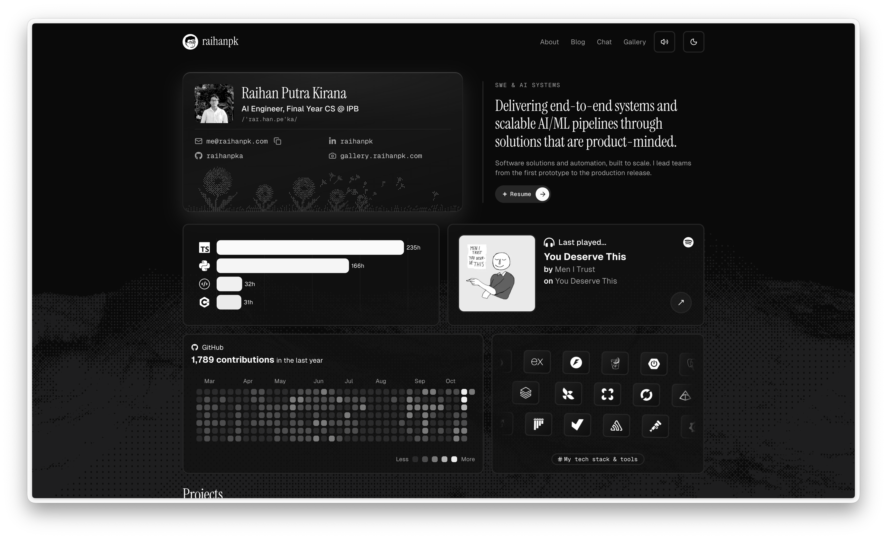
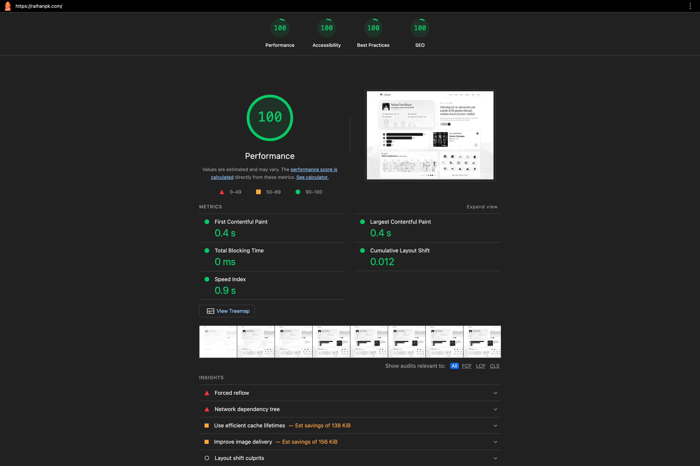

<div align="center">


<br><br>

# @naandalist's website

[Website](https://naandalist.com) &nbsp;&middot;&nbsp; [LinkedIn](https://linkedin.com/in/naandalist) &nbsp;&middot;&nbsp; [Instagram](https://instagram.com/naandalist)


</div>

### about this repo

Source code for [naandalist.com](https://naandalist.com) built with Astro. This website showcases a portfolio, blog, AI chatbot assistant, and interactive widgets such as live Spotify presence, Wakatime coding analytics, and an interactive project showcase.

Additional features developed from built-in features of the public template [Astro Erudite](https://github.com/jktrn/astro-erudite) by [jktrn](https://github.com/jktrn):

- **AI Chatbot**: Personal conversational assistant answering questions using Retrieval-Augmented Generation (RAG) with [Pinecone Vector DB](https://pinecone.io), [Google Gemini / OpenAI](https://ai-sdk.dev), and [Vercel AI SDK](https://sdk.vercel.ai).
- **Spotify Status**: Real-time live presence displaying currently playing and recently scrobbled tracks using [Spotify](https://spotify.com) and [Last.fm](https://last.fm) APIs with SWR caching.
- **Wakatime Analytics**: Weekly coding time breakdown across languages directly from the [Wakatime API](https://wakatime.com) with dynamic dark/light mode icons.
- **Projects Showcase**: Interactive portfolio grid featuring smooth media video previews, modal dialogs, and responsive category filtering.
- **Tech Stack Slider**: 3D-sculpted marquee slider displaying programming languages, frameworks, and cloud infrastructure tools.
- **Blog**: MDX content collections with tags, reading time, and post navigation.
- **GitHub Contributions**: Contribution graph that adapts its number of weeks to the card width, with a keyboard-friendly tooltip. Build-time data is refreshed at runtime from `/api/contributions`, which uses the GitHub GraphQL API when `GITHUB_TOKEN` is set, with a public-page fallback.
- **Profile Card**: Flip card with a dithered baby's breath band and a chat entry on the back.
- **About Page**: Bento cards and a hover scene built from the logo. All the copy for Home and About lives as fields in `src/content/authors/naandalist.md`.
- **Details**: Hand-drawn signature that writes on at each full page load, soft click sounds with a mute toggle, and link tooltips that follow the pointer.
- **Design System**: Tokens for spacing, type, radius, and shadow in `src/styles/global.css`, documented in [`docs/design-system.md`](./docs/design-system.md) and enforced by `bun run check:tokens`.
- **High Performance**: Tuned for Core Web Vitals (Lighthouse desktop on Home: 100 Performance, 100 Accessibility, 100 Best Practices, 100 SEO) with font preloading, WebP assets, deferred islands and media, and build-time avatar optimization. The report is in [`public/scratch`](./public/scratch).

<div align="center">
  
</div>

---

### getting started

This project uses [Bun](https://bun.sh).

```bash
bun install
bun run dev
```

Useful scripts: `bun run build` (type check and build), `bun run check:tokens` (design token lint), `bun test`, and `bun run index-knowledge` (rebuild the chatbot index).

Environment variables go in `.env`. Names only, never commit values: `GITHUB_TOKEN` (optional, read-only), `PINECONE_API_KEY`, `PINECONE_INDEX`, `PINECONE_NAMESPACE`, `GOOGLE_GENERATIVE_AI_API_KEY`, `OPENAI_API_KEY`, `RATE_LIMIT_SECRET`.

---

### tech stack

- **Framework & Core**: [Astro](https://astro.build), [React](https://react.dev), [TypeScript](https://www.typescriptlang.org)
- **Styling**: [Tailwind CSS](https://tailwindcss.com), [tw-animate-css](https://github.com/Wombosvideo/tw-animate-css)
- **Vector & AI**: [Pinecone](https://pinecone.io), [Vercel AI SDK](https://sdk.vercel.ai), [Google Generative AI](https://ai.google.dev), [OpenAI](https://openai.com)
- **UI Components & Animation**: [Radix UI](https://www.radix-ui.com), [Lucide Icons](https://lucide.dev), [React Icons](https://react-icons.github.io/react-icons), [Motion](https://motion.dev), [Recharts](https://recharts.org), [@devnomic/marquee](https://github.com/devnomic/marquee)
- **Deployment**: [Vercel](https://vercel.com)

<div align="center">
<sub>Copyright &copy; 2026 Listiananda Apriliawan. All rights reserved.</sub>
</div>
